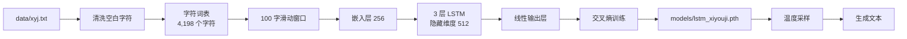

# LSTM 中文文本生成 —— 西游记

用字符级 LSTM 学习《西游记》的语言风格，给一段短开头，续写出风格接近的古典白话文。

[English](README.md) | 简体中文

[](https://www.python.org/)
[](https://pytorch.org/)
[](https://jupyter.org/)
[](#许可证)

## 项目介绍

整个项目只有一个 notebook。训练文本做空白字符归一化后共 734,950 个字符，包含 4,198 个不重复字符。每个汉字算一个 token，模型预测的是下一个字而不是下一个词。这样词表很小，生成时也更容易保留原文的用词习惯，包括人名、诗句片段和对话标点。

流程很直接：读取并清洗文本，建立字符词表，把文本切成 100 字的重叠窗口，用交叉熵训练三层 LSTM 预测下一个字，最后按温度逐字采样出新文本。



| 组件 | 配置 |
| --- | --- |
| 嵌入层 | 4,198 × 256 |
| LSTM | 3 层，隐藏维度 512，batch first |
| Dropout | 0.3，位于 LSTM 层间和输出层之前 |
| 输出层 | Linear 512 → 4,198 |
| 参数量 | 9,001,574（FP32 约 34.3 MB） |
| 优化器 | Adam，学习率 1e-3 |
| 学习率调度 | ReduceLROnPlateau，factor 0.5，patience 3 |
| 精度 | CUDA 下启用自动混合精度 |
| 梯度裁剪 | 最大范数 5 |

## 依赖说明

- Python 3.12
- PyTorch（带 CUDA；notebook 在 Kaggle Tesla T4 上跑过，CPU 也能跑，但慢很多）
- NumPy
- Jupyter Notebook 或 JupyterLab

```bash
pip install torch numpy jupyter;
```

仓库没有 requirements 文件。notebook 只导入了 `torch`、`numpy`、`pickle`、`re`、`os`、`random` 和 `collections`，装上面这些就够了。

## 项目结构

```
.
├── data/
│   └── xyj.txt                  # 《西游记》全文
├── models/
│   └── vocab.pkl                # 字符到索引、索引到字符的映射
├── lstm-text-generated.ipynb    # 数据处理、模型、训练与生成
├── README.md                    # 英文主文档
└── README.zh-CN.md              # 本文件
```

训练好的权重 `models/lstm_xiyouji.pth` 因体积原因没有入库。第一次训练时会自动生成，notebook 里按这个固定路径读取。

## 使用说明

### 1. 训练

打开 `lstm-text-generated.ipynb`，从上到下依次运行。notebook 按常量定义、数据处理、模型定义、训练、生成分块，后面的单元格依赖前面的结果，顺序不能打乱。

运行前先看常量单元格里的数据路径。当前生效的那行指向 Kaggle 数据集，本地运行时改成本仓库里的文件：

```python
DATA_PATH = "./data/xyj.txt";
```

主要参数：

| 参数 | 取值 | 含义 |
| --- | --- | --- |
| `SEQ_LENGTH` | 100 | 每个训练窗口的字符数 |
| `BATCH_SIZE` | 1024 | 每批样本数 |
| `EMBED_DIM` | 256 | 嵌入维度 |
| `HIDDEN_DIM` | 512 | LSTM 隐藏维度 |
| `NUM_LAYERS` | 3 | LSTM 堆叠层数 |
| `DROPOUT` | 0.3 | Dropout 概率 |
| `EPOCHS` | 10 | 训练轮数 |
| `LEARNING_RATE` | 0.001 | Adam 初始学习率 |
| `CONTINUE_TRAIN` | 1 | 存在 `models/lstm_xiyouji.pth` 时继续训练 |
| `GENERATE_LENGTH` | 500 | 采样时生成的字符数 |
| `TEMPERATURE` | 0.1 | 默认采样温度 |

`CONTINUE_TRAIN = 1` 只在检查点存在时生效，文件不存在就直接从头训练。每个 epoch 结束都会保存检查点，里面带优化器状态和当前损失，训练中断后可以接着跑。每次保存后会以“话说”开头生成 200 字样文，方便快速判断当前效果。

检测到多块 GPU 时，notebook 会自动套一层 `DataParallel`。

### 2. 生成

`generate_text` 定义在生成单元格里，先把 notebook 跑到那一格，再加载检查点调用：

```python
model = load_model_for_inference("./models/lstm_xiyouji.pth", "./models/vocab.pkl", device);
text = generate_text(model, start_text="话说", length=500, device=device, temperature=0.8);
print(text);
```

`load_model_for_inference` 会重新读取 `models/vocab.pkl` 中的词表，保证字符映射和权重对得上。它还会去掉权重名里的 `module.` 前缀，因此多卡保存的检查点可以直接在单卡或 CPU 上加载。

notebook 末尾的测试单元格会用四个开头、三个温度组合生成文本，并排打印出来，便于横向比较。

### 3. 温度

- 低于 0.5：结果保守、重复度高，最接近训练原文。
- 0.8 左右：连贯性和变化程度比较平衡。
- 高于 1.0：用词更出人意料，但病句也会明显变多。

采样用的是 `torch.multinomial`，不是取 argmax，所以同一个开头很少连续两次生成完全一样的结果。

## 注意事项

- 强烈建议用 GPU 训练。CPU 上跑一个 epoch（约 73.5 万字、batch size 1024）很慢。
- 生成结果开始胡言乱语时，先调低温度。
- 混合精度用的是 `torch.cuda.amp`。新版 PyTorch 仍能运行，但可能打印弃用警告；没有 CUDA 时走全精度分支。
- 训练文本是公版小说，可以随代码一起分发。

## 贡献指南

欢迎提交 issue 和 pull request。改动模型或训练循环时，请把 notebook 完整跑一遍，并在 PR 里附上损失曲线或生成样例。改动数据集或词表时，请说明旧检查点是否还能用，因为字符集合变了，输出层形状也会跟着变。

## 许可证

仅供学习与研究使用。《西游记》属于公版作品。

## 联系作者

谙弆悕博士（Ailan Anjuxi）

📫 邮箱：anjuxi.ME@outlook.com

📞 SIP 电话：sip:anjuxi@sip.linphone.org
